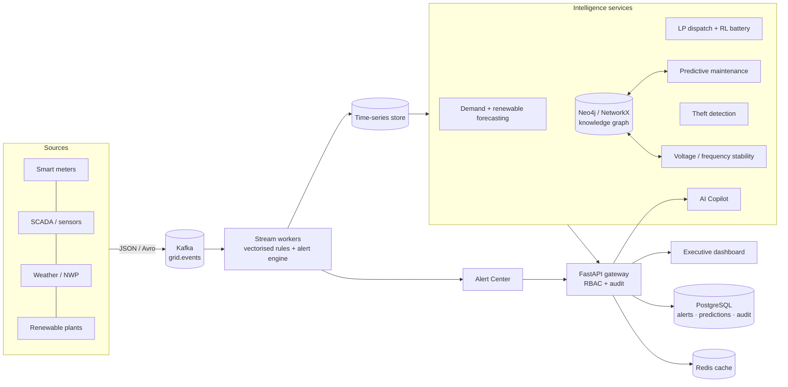

# Architecture

## Data flow
1. Telemetry → Kafka topic (partition by substation). 2. Workers consume micro-batches, update per-asset state, raise alerts
(de-duplicated by type+asset, escalation bypasses cooldown), persist to PostgreSQL. 3. Batch/online models (forecast, maintenance, theft)
read curated features; results are cached (Redis) and exposed through the API. 4. The knowledge graph links plants → lines → substations →
transformers → meters/consumers and is used for impact analysis, risk propagation and switching plans. 5. The copilot routes a question
to a tool, which calls the same services as the REST API; answers are built from tool output only.

## Key design decisions
- **Optional dependencies with fallbacks** (XGBoost→sklearn, Kafka→in-memory bus, Neo4j→NetworkX, Redis→TTL dict, Postgres→SQLite) so the same code runs on a laptop and in the cluster.
- **LP rather than black-box RL for dispatch**: guarantees feasibility, gives marginal prices (duals) and is auditable; RL is used only where decisions are sequential under price uncertainty (battery).
- **Explainability by construction**: additive voltage model, occlusion explanations for tree models, rule+score evidence for theft.
- **Hash-chained audit log** (sha256(prev‖record)) in DB and JSONL; `/audit/verify` detects edits.

## Scaling plan (to 18 M meters / 100 M events/day)
| Concern | Demo | Production |
|---|---|---|
| Ingest | in-memory bus | Kafka, 12–48 partitions, consumer group; `scripts/stream_worker.py` |
| Meter analytics | pandas pivot | Spark / Dask or ClickHouse materialised views; per-feeder batching |
| Graph | NetworkX (6 k nodes) | Neo4j cluster (`/graph/export-neo4j`), GDS for centrality/GNN |
| Models | trained at start-up | scheduled training jobs, model registry, load at start-up |
| API | single process | stateless replicas behind LB, Redis cache, Postgres HA |
